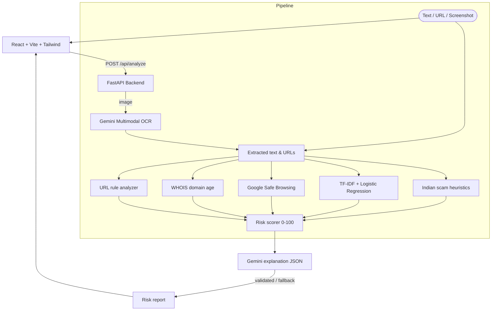

✨ Features
Detection
🔍 Universal Analyzer – paste a message or URL, or upload a screenshot (Gemini OCR) and get a 0–100 risk score with a Safe / Suspicious / Dangerous verdict.
🧠 Hybrid engine – URL rules + WHOIS domain age + Google Safe Browsing + TF-IDF ML classifier + Indian scam text heuristics, then Gemini writes a plain-language explanation.
🔴 Inline red-flag highlighting in the analyzed text.
📦 APK Inspector – statically inspects an uploaded `.apk` (never executes it).
📞 Scam Number Lookup and 💸 UPI VPA / Link Verifier.
🏦 Bank Alert Validator and 🚔 Digital Arrest Shield.
Response & community
🚨 "I already clicked / paid" emergency checklist (1930 helpline, cybercrime.gov.in, bank/UPI blocking).
📝 Chakshu Reporter helper, 🧱 Community Threat Wall, 🗺️ Live Threat Map, 📡 Live Scam Feed.
🎓 Safety Quiz and FAQ for awareness.
Accessibility
🌐 Explanations in English, Hindi, Kannada, Tamil, Telugu.
🔊 Text-to-speech "Listen" button.
🔒 Messages and screenshots are processed in memory, not stored.
🛟 Works without API keys, using rule-based and template fallback mode.
---
🏗️ Architecture

> The backend **never visits** a suspicious URL. It only analyzes the string, WHOIS data and Safe Browsing reputation.
---
📁 Project Structure
```
SCAM_SHIELD_AI/
├── backend/
│   ├── app/
│   │   ├── main.py            # FastAPI routes
│   │   ├── schemas.py         # Pydantic models
│   │   ├── config.py          # Settings (.env)
│   │   ├── services/          # url_analyzer, whois, safe_browsing, ml_classifier,
│   │   │                      # text_heuristics, risk_scorer, gemini, apk, lookup
│   │   └── tests/             # pytest unit tests
│   ├── requirements.txt
│   └── Dockerfile
├── frontend/                  # React + Vite + Tailwind UI
├── ml/
│   ├── train_model.py
│   ├── dataset_notes.md
│   └── saved_models/scam_model.pkl
├── test_e2e_samples.py
├── .env.example
└── README.md
```
---
🔌 API
Method	Endpoint	Purpose
GET	`/api/health`	Health + which API keys are configured
GET	`/api/samples`	Demo samples
POST	`/api/analyze`	Analyze text / URL
POST	`/api/analyze-image`	Analyze screenshot (≤10 MB)
POST	`/api/inspect-apk`	Static APK inspection
POST	`/api/lookup-number`	Phone number lookup
POST	`/api/verify-vpa`	UPI VPA / link check
POST	`/api/report-scam`	Submit a community report
GET	`/api/community-reports`	List community reports
Interactive docs are at `http://127.0.0.1:8000/docs` once the backend is running.
---
🤖 ML Model
Vectorizer: `TfidfVectorizer` (1–2 grams, 3000 features, sublinear TF)
Classifier: `CalibratedClassifierCV(LogisticRegression)`
Data: SMS Spam Collection + a handcrafted corpus of Indian scams (fake SBI/HDFC KYC, electricity disconnection, UPI cashback, India Post fees, KBC lottery, WFH Telegram jobs)
Details in `ml/dataset_notes.md`
> ⚠️ The model scores very high on the bundled dataset, but that dataset is small and partly synthetic. Treat the metrics as a prototype baseline, not real-world accuracy. This is why the ML score is only one signal in the hybrid pipeline.
---
🚀 Getting Started
Prerequisites
Python 3.10+
Node.js 18+ and npm
1. Clone
```bash
git clone https://github.com/tharunyadavts-coder/SCAM_SHIELD_AI.git
cd SCAM_SHIELD_AI
```
2. Environment
```bash
cp .env.example .env
```
```env
GEMINI_API_KEY=your_gemini_api_key_here
SAFE_BROWSING_API_KEY=your_google_safe_browsing_api_key_here
PORT=8000
```
Both keys are optional. Without them the app falls back to rule-based analysis and template explanations.
3. Backend
```bash
pip install -r backend/requirements.txt
python ml/train_model.py          # optional: retrain the model
PYTHONPATH=backend python -m pytest backend/app/tests
PYTHONPATH=backend uvicorn app.main:app --host 127.0.0.1 --port 8000
```
4. Frontend
```bash
cd frontend
npm install
npm run dev -- --host 127.0.0.1 --port 3000
```
Open http://127.0.0.1:3000 (Vite proxies `/api` to port 8000).
---
🐳 Docker & Cloud Run
```bash
docker build -t gcr.io/YOUR_PROJECT_ID/scamshield-ai:latest -f backend/Dockerfile .
docker push gcr.io/YOUR_PROJECT_ID/scamshield-ai:latest

gcloud run deploy scamshield-ai \
  --image gcr.io/YOUR_PROJECT_ID/scamshield-ai:latest \
  --platform managed \
  --region asia-south1 \
  --allow-unauthenticated \
  --set-env-vars GEMINI_API_KEY=YOUR_KEY,SAFE_BROWSING_API_KEY=YOUR_KEY
```
---
🛠️ Tech Stack
Layer	Tech
Backend	Python 3.10, FastAPI, Pydantic, Uvicorn, scikit-learn, python-whois, pytest
Frontend	React 18, Vite, Tailwind CSS, Framer Motion, Lucide icons
AI / Cloud	Gemini 2.5 Flash (`google-genai`), Google Safe Browsing v4, Cloud Run
---
⚠️ Disclaimer
ScamShield AI is a decision-support tool, not a guarantee. If you've lost money, call 1930 (National Cyber Crime Helpline) immediately and report at cybercrime.gov.in.
---
👥 Team
Built for the Google Hackathon by the ScamShield AI team.
📄 License
MIT. Add a `LICENSE` file to the repo root to match the badge.
